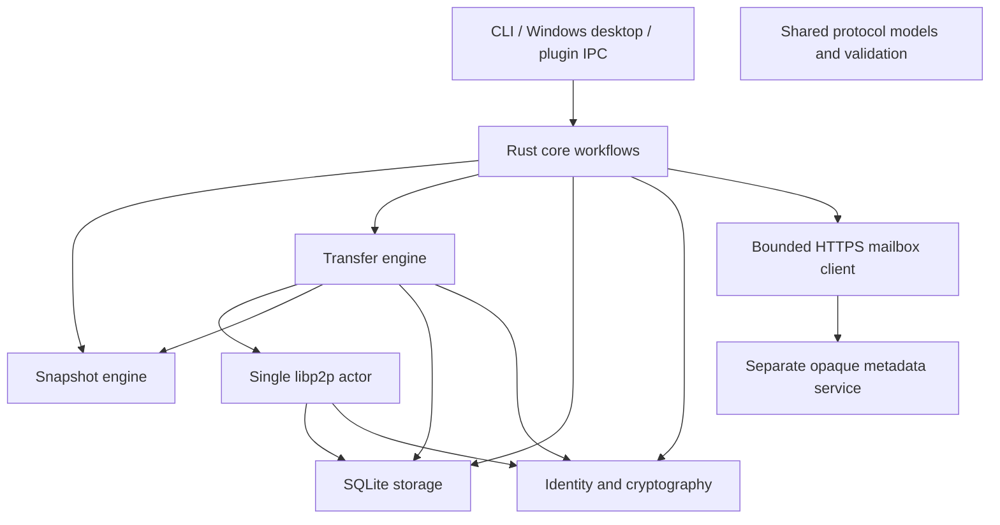

# Architecture and invariants

## Responsibility boundaries



All crates use shared protocol types as needed. Storage persists domain records; it does not open peer connections. Snapshot code handles local files; it does not publish metadata. Core coordinates workflows. Desktop commands and the VST3 Named Pipe bridge are adapters sharing their owner's Engine and network handle. Networking, blocking disk work, plugin IPC and UI remain separately owned; the audio callback only passes audio buffers.

Private peers authenticate through QUIC or Noise. TCP uses Yamux. A pinned relay/rendezvous service helps trusted peers connect; the client has no public DHT or multicast discovery. Project data may cross a relay fallback, with authenticated peer transport. The mailbox stores encrypted announcements only.

## Setup roles and documentation

The [setup entry point](setup/README.md) separates [sender/host preparation](setup/host/README.md) from [receiving peer preparation](setup/peer/README.md). Host means the source of the first snapshot, not a central server or a persistent master role. The receiver initiates the first connection to the reachable source. An established connection carries authorized project requests both ways; independent reverse dialing after disconnect needs its own reachable path. Each CLI network job stops its runtime on completion; Desktop/serve keep explicit sessions.

Initial discovery uses the invitation's signed inviter identity and addresses. Import persists a local project/peer row, not an online/equality claim; starting Desktop alone notifies no recipient. In the default direct trial, changed public IP/port is updated by native import of a new invitation into the same profile/project/folder. Configured private rendezvous/relay provide trusted discovery/reservations, with separate operator ACLs; they are not deployed/validated simply by filling a UI field. Local SQLite already owns trust/history/transfer data. Browser hosting, Supabase and offline enrollment storage are not integrated; mailbox SQLite stores encrypted snapshot announcements only.

Pending pairing candidates are proof-verified public identities held only in an ephemeral core window, with no per-candidate live indicator or audit history. Approved peers appear in the local collaborator list; Desktop displays current route/transport for the selected peer. Unimported recipients and all unauthorized network attempts are not exposed as an inbox. Native approval changes local project authorization and never automatically grants private infrastructure access.

Setup documents describe existing adapters and manual router/firewall configuration. They do not introduce another swarm, installer, continuous sync or automatic network administration. [The peer package template](setup/peer/CLAUDE.md) drives native CLI operations without exposing invitation payloads to the agent; the root [CLAUDE.md](../CLAUDE.md) instead routes repository development. Actual validation evidence remains in [IMPLEMENTATION.md](IMPLEMENTATION.md).

## Local snapshot commit

1. Acquire the Windows project lock; refuse snapshotting during recovery.
2. Inventory/hash the folder using fixed chunks; reject unsafe paths/reparse points and unstable files.
3. Persist verified chunks to the local content store.
4. Sign the complete immutable manifest. Unchanged files reuse the current snapshot.
5. Commit snapshot, files, chunk index/catalog, and new local head in one SQLite transaction with an expected-head check.
6. Keep authored metadata `PENDING` until the mailbox client receives a matching server ACK.

The scanner omits only Ableton `.asd` analysis files, the top-level `Backup/` tree, and Windows/macOS metadata files (`desktop.ini`, `Thumbs.db`, `ehthumbs.db`, `.DS_Store`). These files neither delay save settlement nor enter new manifests. Older signed manifests remain unchanged; comparisons filter those paths on both sides, and receive leaves ignored files in the working folder without moving or overwriting them. A folder with no remaining project files cannot be shared as its first snapshot.

The working folder may change after a snapshot. Retained chunk data keeps the committed snapshot retrievable. Automatic pruning is outside the current implementation.

An accepted `SAVE_OBSERVED` starts a bounded project job. Observations coalesce for a two-second quiet period (60-second debounce limit); new observations during active work request a settled follow-up pass. With the same project lock/recovery guard held, a blocking worker samples path/size/mtime inventory every 500 ms until it has been unchanged for two seconds and Windows read handles deny active writers. Settlement has a 60-second wait limit and at most three guarded scanner attempts. Hashing a stable large project may exceed the wait limit; partial manifests never commit. Unchanged content reuses its head. This is triggered by IPC events, with no continuous filesystem watcher. A quiet inventory is a conservative heuristic, not proof of host save completion.

## Metadata publication and refresh

Core persists one encrypted signed envelope before its first POST and reuses it after failure or ACK loss. The service authenticates a short-lived signed request against its explicit project/device ACL, durably rejects nonce replay, and returns an idempotent sequence/ACK only after the opaque record commits. The agent's ACK update matches its durable envelope. HTTP authentication has a separate domain/model; existing envelope/signing/AAD serialization is unchanged.

Refresh verifies ordered bounded records, project membership, paired author/key, signature, AEAD, and immutable-history consistency. Storage checks authorization again under the transaction and commits the complete page plus its expected cursor together. It does not change the project head, local chunk availability, or verified equality. Disk/SQLite/DPAPI operations run in blocking workers outside the swarm. `MailboxRuntime` retries every 30 seconds while its desktop/CLI owner is active; committed pending envelopes survive restart. Plugin owners remain alive while authored publication is pending, even after DAW/window closure. A narrow SQLite EXISTS query runs in a blocking worker; no manifest/history scan is needed for lifetime.

Desktop close hides the window and releases its explicit window session. Starting desktop again shows that same owner and retains an explicit window session until the next close. Plugin-launched desktop uses `--plugin-owner`; repeat plugin launches do not manufacture an explicit window session. With no window session, bound plugin, accepted desktop/plugin job, active peer response or pending authored publication, 60 quiet seconds precede shutdown. Plugin and responder activity epochs capture short operations between lifetime polls. Idle IPC shutdown claims the same lock as connection/job acceptance. Shutdown drains local work before stopping metadata and the single peer runtime. Pending publication with an unavailable or missing mailbox retains the owner until ACK or explicit process interruption; there is no installed permanent service.

The Axum service binds loopback behind HTTPS; its SQLite data is independent from local history. The private relay/rendezvous runs in another process with a retained DPAPI identity and a fail-closed signed-card allow-list. It has no transfer-serving behavior. Operator workflow and limits are in [PHASE3.md](PHASE3.md).

## Receive and recovery

```text
authenticate/authorize → validate signed ancestry → reject divergence/local edits
→ acquire/retain project lock → rehash cache → download missing chunks
→ assemble and full-file-verify staging data → persist journal
→ SQLite recovery marker + APPLYING → BACKUP → INSTALL → COMMIT → DONE
→ clear recovery marker + COMPLETE → optional online peer equality ACK
```

The normal receive path still refuses local edits and divergent histories. An explicit, confirmed “Use collaborator's version” path first snapshots changed local work without announcing it, then permits a divergent target while retaining the same signed ancestry checks, project lock, clean-base validation and apply journal. The previous files remain in the transfer's sibling `backup` folder. Projects are never merged and no divergence is silently overwritten.

- A chunk is complete only after hash verification and durable chunk-store installation. SQLite progress is not a substitute for rehashing the cache on resume.
- Staging and backups are siblings of the project on its volume. Backups are retained. Only empty directories are removed; no recursive deletion applies snapshots.
- Original files are reverified while a Windows handle denies writers. Installed files arrive by atomic rename from complete, verified staging files.
- The journal is fsynced and atomically replaced. Its identifiers/file lists must match the signed target and local base.
- `begin_apply` sets recovery-required and `APPLYING` together before any original moves. `commit_local` advances history only after a full final-folder scan matches the signed manifest.
- An interrupted `INSTALL` verifies already installed files instead of recreating moved staging files. Recovery works without a peer connection.
- Blocking apply retains the project lock even if its asynchronous caller is cancelled. DAW closure is a user prerequisite, not an automatic host lock guarantee.
- A transfer can be locally complete while its source is unavailable for the final equality ACK. Completion and online verification are distinct facts.

## State contracts

| Contract | Owner | Stable values |
| --- | --- | --- |
| Transfer session | `storage::TransferState` | `QUEUED`, `RECEIVING`, `PAUSED`, `APPLYING`, `RECOVERY_REQUIRED`, `COMPLETE` |
| Apply journal phase | `transfer::journal::ApplyPhase` | `BACKUP`, `INSTALL`, `COMMIT`, `DONE` |
| Snapshot location | SQLite | `LOCAL`, `REMOTE` |
| Metadata status | SQLite | `PENDING`, `PUBLISHED`, `REMOTE` |
| Lineage | `storage::Lineage` | `EQUAL`, `REMOTE_AHEAD`, `LOCAL_AHEAD`, `DIVERGED`, `UNKNOWN` |
| Connection route | Network status | `DIRECT`, `RELAYED`, `OFFLINE` |

Typed transfer state conversion preserves existing schema-v2 text/JSON labels; unsupported persisted values produce an error. It does not introduce a new transition framework or schema migration. Receiver/apply/storage methods explicitly own transitions and transactions.

## Trust and compatibility rules

- The signed application public key must derive the advertised PeerId. Device UUID bindings cannot silently replace keys. A project supports this device plus at most two explicitly paired devices.
- Transport allow lists include paired devices and pinned infrastructure. An explicit short-lived pairing window permits at most four temporary inbound connections for enrollment only; outbound discovery still uses trust. Every inbound/outbound project request also checks project authorization; infrastructure receives no implicit project-data access.
- Every fetched manifest/ancestor validates structure, manifest hash, Ed25519 signature, project/requested snapshot ID, and trusted author key. An own-device author must match the own public key too.
- Preserve protocol version, domain separators, signing bytes, field order, AAD, binary framing, manifest/chunk limits, and relative-path validation when moving code.
- Preserve SQL transaction boundaries, expected-head checks, schema version, durable filenames, and journal fields. A refactor alone is not a format migration.
- `PUBLISHED` requires a mailbox ACK. Received copies are `REMOTE`; direct transfer is not publication.
- `UP TO DATE` requires fresh contact and verified equality. Offline views show last-known history and last verification; they cannot promise a download from an offline source.

Automatic enrollment is core-owned in `crates/core/src/pairing.rs`; [security details](setup/PAIRING_SECURITY.md) describe the isolated `/trackmesh/pairing/1` channel. It shares the single swarm and leaves transfer/invitation/card serialization and database values unchanged. The native Desktop opens the window and presents candidates; approval calls existing core pairing/storage authorization.

Actual module owners are listed in [CODEMAP.md](CODEMAP.md). Full accepted scope is in [MVP.md](MVP.md).
