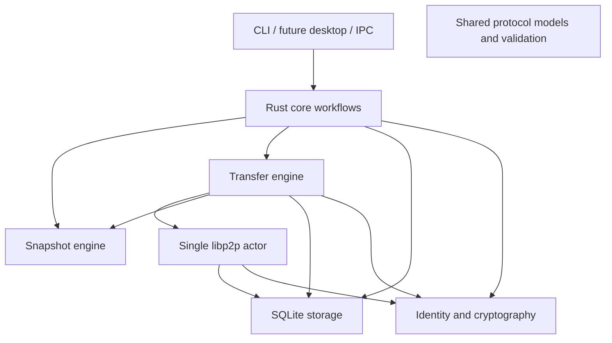

# Architecture and invariants

## Responsibility boundaries



All crates use shared protocol types as needed. Storage persists domain records; it does not open peer connections. Snapshot code handles local files; it does not publish metadata. Core coordinates workflows. UI and the VST3 bridge are future adapters. Networking, disk work, and UI remain separately owned.

Private peers authenticate through QUIC or Noise. TCP uses Yamux. A pinned relay/rendezvous service helps trusted peers connect; the client has no public DHT or multicast discovery. Project data may cross a relay fallback, with authenticated peer transport. The mailbox stores encrypted announcements only.

## Local snapshot commit

1. Acquire the Windows project lock; refuse snapshotting during recovery.
2. Inventory/hash the folder using fixed chunks; reject unsafe paths/reparse points and unstable files.
3. Persist verified chunks to the local content store.
4. Sign the complete immutable manifest. Unchanged files reuse the current snapshot.
5. Commit snapshot, files, chunk index/catalog, and new local head in one SQLite transaction with an expected-head check.
6. Keep authored metadata `PENDING` until the future mailbox client receives a server ACK.

The working folder may change after a snapshot. Retained chunk data keeps the committed snapshot retrievable. Automatic pruning is outside the current implementation.

## Receive and recovery

```text
authenticate/authorize → validate signed ancestry → reject divergence/local edits
→ acquire/retain project lock → rehash cache → download missing chunks
→ assemble and full-file-verify staging data → persist journal
→ SQLite recovery marker + APPLYING → BACKUP → INSTALL → COMMIT → DONE
→ clear recovery marker + COMPLETE → optional online peer equality ACK
```

- A chunk is complete only after hash verification and durable chunk-store installation. SQLite progress is not a substitute for rehashing the cache on resume.
- Staging and backups are siblings of the project on its volume. Backups are retained. Only empty directories are removed; no recursive deletion applies snapshots.
- Original files are reverified while a Windows handle denies writers. Installed files arrive by atomic rename from complete, verified staging files.
- The journal is fsynced and atomically replaced. Its identifiers/file lists must match the signed target and local base.
- `begin_apply` sets recovery-required and `APPLYING` together before any original moves. `commit_local` advances history only after a full final-folder scan matches the signed manifest.
- An interrupted `INSTALL` verifies already installed files instead of recreating moved staging files. Recovery works without a peer connection.
- Blocking apply retains the project lock even if its asynchronous caller is cancelled. DAW closure is a user prerequisite, not an automatic host lock guarantee.
- A transfer can be locally complete while its source is unavailable for the final equality ACK. Completion and online verification are distinct facts.

## State contracts

| Contract | Owner | Stable values |
| --- | --- | --- |
| Transfer session | `storage::TransferState` | `QUEUED`, `RECEIVING`, `PAUSED`, `APPLYING`, `RECOVERY_REQUIRED`, `COMPLETE` |
| Apply journal phase | `transfer::journal::ApplyPhase` | `BACKUP`, `INSTALL`, `COMMIT`, `DONE` |
| Snapshot location | SQLite | `LOCAL`, `REMOTE` |
| Metadata status | SQLite | `PENDING`, `PUBLISHED`, `REMOTE` |
| Lineage | `storage::Lineage` | `EQUAL`, `REMOTE_AHEAD`, `LOCAL_AHEAD`, `DIVERGED`, `UNKNOWN` |
| Connection route | Network status | `DIRECT`, `RELAYED`, `OFFLINE` |

Typed transfer state conversion preserves existing schema-v2 text/JSON labels; unsupported persisted values produce an error. It does not introduce a new transition framework or schema migration. Receiver/apply/storage methods explicitly own transitions and transactions.

## Trust and compatibility rules

- The signed application public key must derive the advertised PeerId. Device UUID bindings cannot silently replace keys. A project supports this device plus at most two explicitly paired devices.
- Transport allow lists include paired devices and pinned infrastructure. Every inbound/outbound project request also checks project authorization; infrastructure receives no implicit project-data access.
- Every fetched manifest/ancestor validates structure, manifest hash, Ed25519 signature, project/requested snapshot ID, and trusted author key. An own-device author must match the own public key too.
- Preserve protocol version, domain separators, signing bytes, field order, AAD, binary framing, manifest/chunk limits, and relative-path validation when moving code.
- Preserve SQL transaction boundaries, expected-head checks, schema version, durable filenames, and journal fields. A refactor alone is not a format migration.
- `PUBLISHED` requires a mailbox ACK. Received copies are `REMOTE`; direct transfer is not publication.
- `UP TO DATE` requires fresh contact and verified equality. Offline views show last-known history and last verification; they cannot promise a download from an offline source.

Actual module owners are listed in [CODEMAP.md](CODEMAP.md). Full accepted scope is in [MVP.md](MVP.md).
